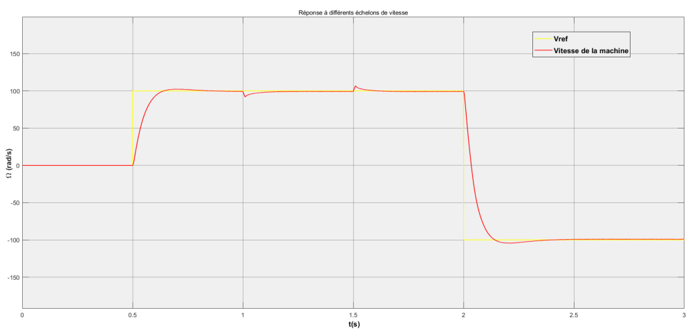
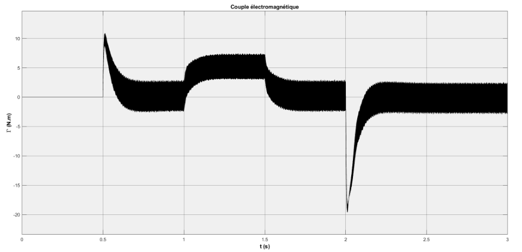

# Induction Motor Direct Vector Control

MATLAB/Simulink models of a three-phase induction motor using direct field-oriented control. The project studies speed tracking, current and flux regulation, load changes and field weakening.

## What it does

- Models the machine using Clarke/Park transformations and dq equations.
- Regulates current, rotor flux and speed through a controlled inverter drive.
- Compares startup and load response with the controlled-drive behavior.
- Explores operation above base speed through field weakening.

## Results

Figures from the [technical report](docs/induction-motor-vector-control-report.pdf).

### Speed tracking and reversal

The reported test follows a 100 rad/s speed reference, applies load changes, and reverses the reference to -100 rad/s.



### Electromagnetic torque



## Tools

MATLAB, Simulink and Simscape Electrical Specialized Power Systems.

## Run

```matlab
induction_motor_parameters
open_system('induction_motor_foc.slx')
```

Run the model and inspect the speed, current, torque and flux scopes. Open `induction_motor_load_step.slx` for the startup and load-torque study.

## Project files

| File | Purpose |
| --- | --- |
| `induction_motor_parameters.m` | Machine parameters and controller gains |
| `induction_motor_foc.slx` | Direct field-oriented control |
| `induction_motor_load_step.slx` | Startup and load study |

Developed as a collaborative academic engineering project.
