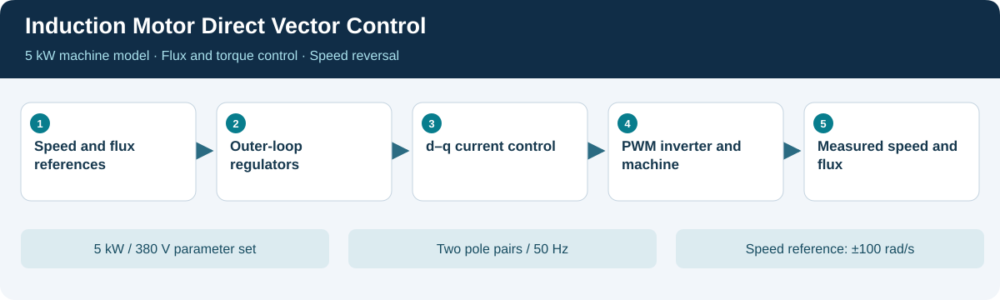
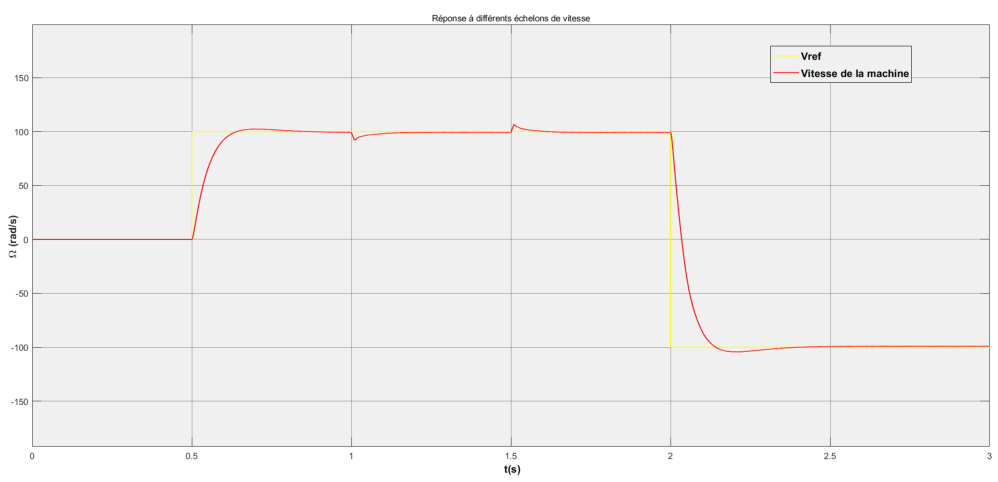
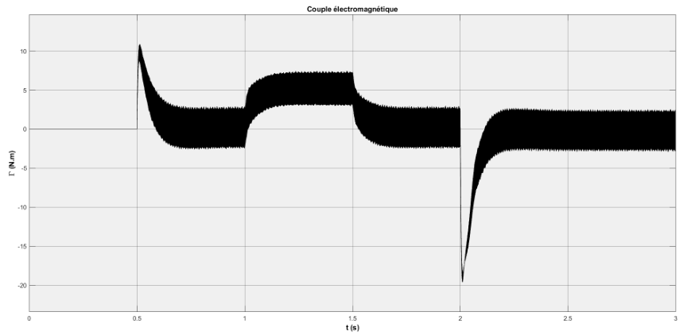

# Induction Motor Direct Vector Control

**5 kW machine model · Flux and torque control · Speed reversal**

A MATLAB/Simulink study of direct field-oriented control for a voltage-fed three-phase induction motor. The project connects the machine model, coordinate transformations, current regulators, rotor-flux regulation and speed control.

Academic group project at the National Polytechnic School of Algiers.



## What is controlled

Field-oriented control expresses the stator current in a rotating frame aligned with rotor flux. The direct-axis current primarily establishes flux, while the quadrature-axis current produces torque. This makes the machine easier to regulate through nested loops.

| Stage | Role |
|---|---|
| Clarke and Park transformations | Express three-phase quantities in stationary and rotating frames |
| Current control | Regulate the electrical variables closest to the inverter |
| Rotor-flux control | Maintain the commanded magnetic state |
| Speed control | Produce the torque-current demand from speed error |
| PWM inverter | Apply switching voltages to the machine |
| Feedback | Return currents, speed and flux information to the controllers |

## Machine parameters

The values below come from `induction_motor_parameters.m`.

| Parameter | Value |
|---|---:|
| Rated power parameter | 5,000 W |
| Voltage parameter | 380 V |
| Current parameter | 10.5 A |
| Pole pairs | 2 |
| Frequency | 50 Hz |
| Stator / rotor resistance | 0.435 Ω / 0.816 Ω |
| Stator / rotor inductance | 71 mH / 71 mH |
| Mutual inductance | 69 mH |
| Inertia | 0.0056 kg·m² |

For rotor-flux orientation, the torque relationship is:

$$T_e=\frac32p\frac{L_m}{L_r}\psi_r i_q$$

The rotor time constant and leakage factor used in the model are:

$$\tau_r=\frac{L_r}{R_r},\qquad
\sigma=1-\frac{L_m^2}{L_sL_r}$$

These quantities link the physical machine parameters to the dynamic model and regulator settings.

## Simulation results from the report

### Speed tracking and reversal



The documented sequence tracks a 100 rad/s reference, includes load changes and then reverses the reference to −100 rad/s. Read the reference and measured-speed curves together to assess the transient response.

### Electromagnetic torque



The torque trace shows the effort required during acceleration, load changes and reversal. These figures are from the [technical report](docs/induction-motor-vector-control-report.pdf).

## Why these design choices

The rotating frame separates flux and torque commands. Nested loops place the faster current regulation inside the slower mechanical-speed loop. A separate startup/load-step model makes the machine response easier to study alongside the complete controlled drive. The report also examines field weakening above base speed.

## Run the models

```matlab
induction_motor_parameters
open_system('induction_motor_foc.slx')
```

Run the model and inspect speed, torque, currents and flux scopes. Open `induction_motor_load_step.slx` for the separate startup/load study. Initialize the parameter script before each model session.

## Files and tools

| File | Contents |
|---|---|
| `induction_motor_parameters.m` | Machine parameters and regulator calculations |
| `induction_motor_foc.slx` | Field-oriented drive |
| `induction_motor_load_step.slx` | Startup and load response |
| [Report](docs/induction-motor-vector-control-report.pdf) | Equations, control structure and results |

**Tools:** MATLAB, Simulink and Simscape Electrical Specialized Power Systems.

## Related projects

[Permanent Magnet Synchronous Generator](https://github.com/MouaadO/permanent-magnet-generator) · [Inverter Modulation and PWM](https://github.com/MouaadO/inverter-pwm-experimental-validation)
